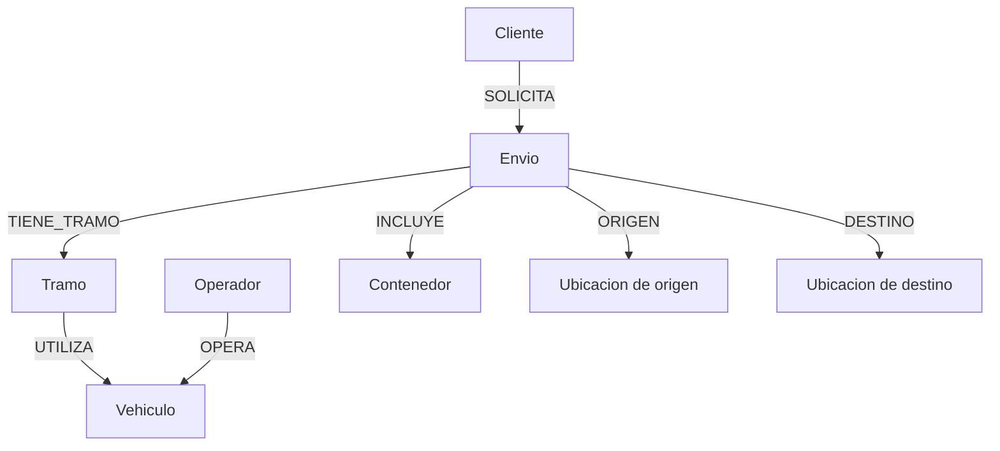
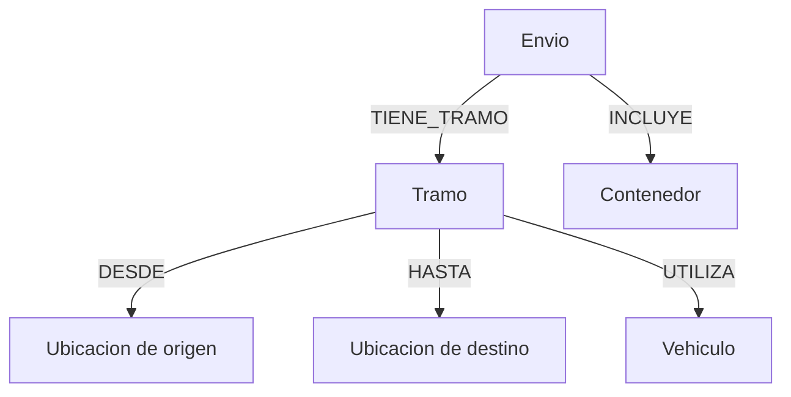
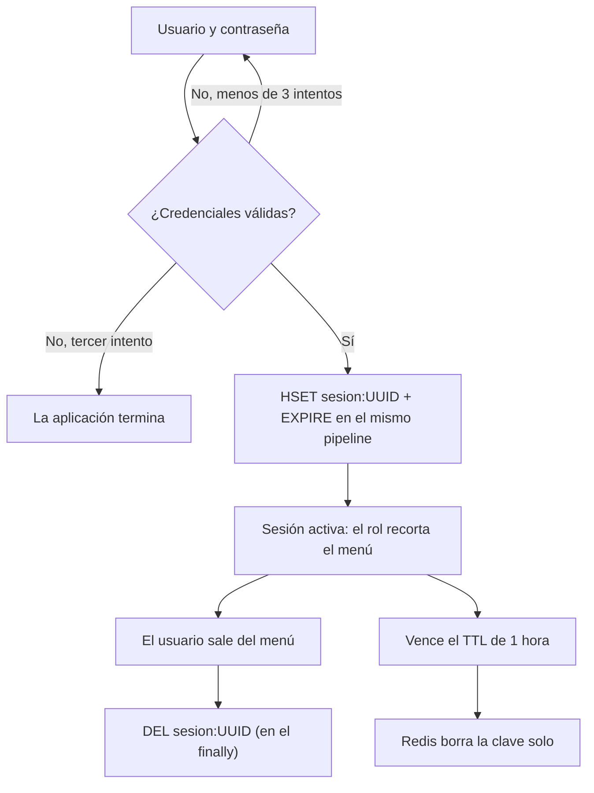
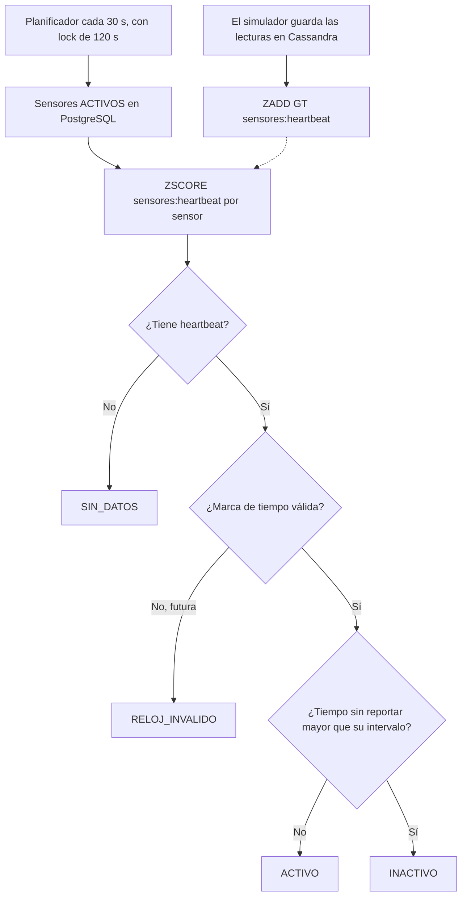
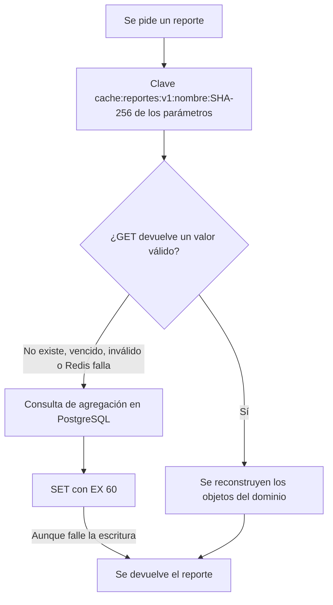
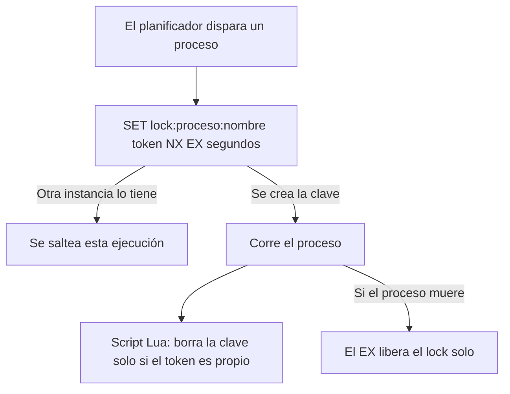

# Diagramas de Redis y Neo4j

Responsable: UMBI

Los diagramas representan los modelos implementados. Las decisiones que los
justifican están en `docs/decisiones.md` (D9, D11, D13, D14, D37, D42, D43 y D44).

## Neo4j: actores y envíos

Las cajas representan etiquetas de nodos y las flechas,
relaciones dirigidas. Las dos ubicaciones tienen la misma
etiqueta `Ubicacion`, pero cumplen distintos roles.

## Neo4j: tramos y movimientos

Cada tramo tiene un `id` y un `orden` dentro del envío.
Los contenedores se relacionan con los tramos a través del envío.
Esta relación no confirma que el contenedor haya recorrido
efectivamente cada tramo.

## Redis: ciclo de una sesión — D42

El Hash contiene `usuario_id`, `fecha_inicio`, `fecha_fin` y `estado`.
El UUID de la clave identifica la sesión.

La sesión dura una hora. El TTL no se pasa aparte: se calcula a partir de
`fecha_fin`, redondeando hacia arriba. El `HSET` y el `EXPIRE` van en un
pipeline transaccional para que nunca quede una sesión sin vencimiento.
Las sesiones activas se listan con `SCAN`, no con `KEYS`.

## Redis: actividad de sensores — D13 y D43

El score es el timestamp Unix del último reporte. `ZADD` con `GT` evita que una
señal vieja pise una más nueva. El Sorted Set no tiene TTL.

El heartbeat se registra después de guardar las lecturas en Cassandra, para que
una señal nunca afirme un dato que no se escribió. Cada sensor se compara contra
su propio `intervalo_reporte_segundos`.

`SIN_DATOS` no es `INACTIVO`: la falta de heartbeat no distingue un sensor nuevo
de una pérdida de datos de Redis. Un error de Redis se informa como falla del
proceso, nunca como inactividad. El resultado se registra en el log; el proceso
no cambia el estado del sensor en PostgreSQL.

## Redis: caché de reportes — D44

Los siete reportes de `ReporteService` se cachean 60 segundos. La caché es un
atajo, nunca una dependencia: si Redis falla, el reporte sale igual desde
PostgreSQL. Durante esos 60 segundos puede mostrar datos anteriores al último
cambio, porque no hay invalidación inmediata. Facturación, estados de envío y
saldos no se cachean.

## Redis: locks de procesos periódicos — D14

Lo usan la sincronización del Outbox, el chequeo de consistencia, la facturación
automática, el cierre mensual, la verificación de saldos y la detección de
sensores inactivos. El lock reduce las ejecuciones simultáneas, pero no reemplaza
la idempotencia en PostgreSQL.
