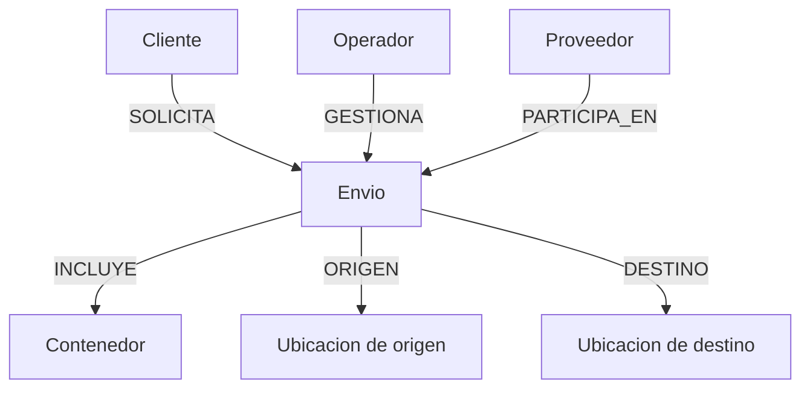
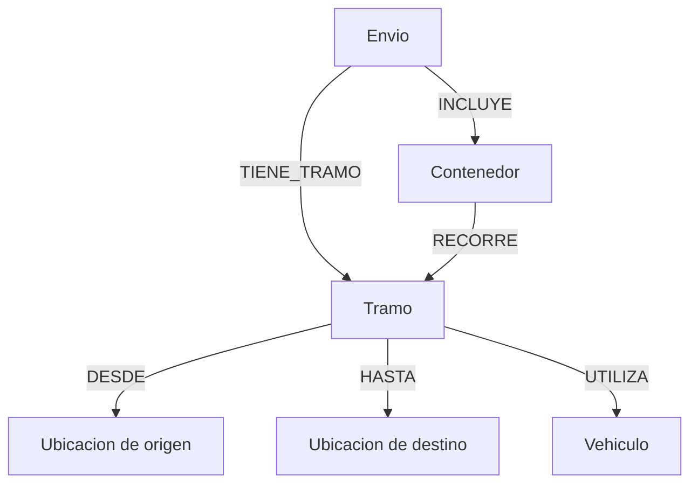
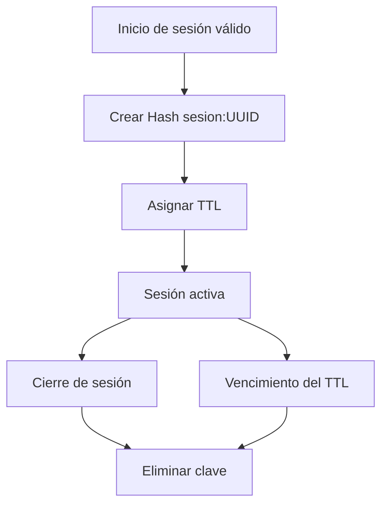
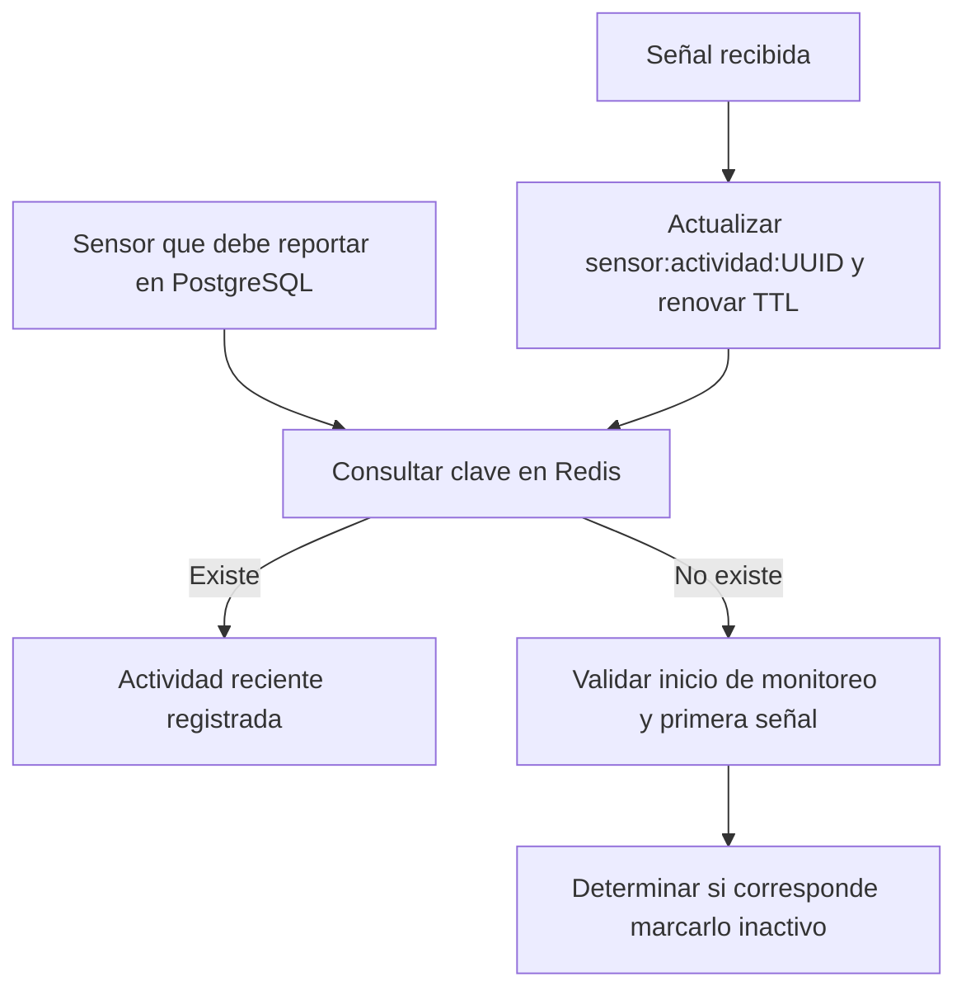

# Diagramas de Redis y Neo4j

Responsable: UMBI

Los diagramas representan los modelos iniciales propuestos.

## Neo4j: actores y envíos

Las cajas representan etiquetas de nodos y las flechas,
relaciones dirigidas. Las dos ubicaciones tienen la misma
etiqueta `Ubicacion`, pero cumplen distintos roles.

## Neo4j: tramos y movimientos

Cada tramo tendrá un `id` y un `orden` dentro del envío.
La relación `RECORRE` identifica los tramos de cada contenedor.
Las fechas reales permitirán consultar los movimientos realizados.

## Redis: ciclo de una sesión

El Hash contiene `usuario_id`, `fecha_inicio`, `fecha_fin`
y `estado`. El UUID de la clave identifica la sesión.

La duración del TTL queda pendiente de acordar con el grupo.

## Redis: actividad de sensores

El valor de la clave contiene la fecha y hora de recepción
de la última señal.

La ausencia de la clave requiere comprobar el contexto del
sensor antes de clasificarlo como inactivo. Un error de conexión
con Redis no debe interpretarse como ausencia de actividad.

El TTL y el período inicial de espera se acordarán con el grupo.